<div align="center">

  <!-- Terminal Banner -->
  

  <br/><br/>

  <!-- Social & Communication Badges -->
  <a href="https://github.com/koushikgit2024">
    
  </a>
  &nbsp;
  <a href="https://linkedin.com/in/koushik-kar-409489329">
    
  </a>
  &nbsp;
  <a href="mailto:koushikkar712@gmail.com">
    
  </a>
  &nbsp;
  <a href="https://instagram.com/chidanand013">
    
  </a>

  <br/><br/>

  

</div>

---

### `01 / SYSTEM_IDENTITY`

```console
koushik@devbox:~$ whoami
Koushik Kar

koushik@devbox:~$ role
Full-Stack Developer | Systems & Backend Engineer | ECE Undergrad

koushik@devbox:~$ institution
National Institute of Technology Agartala · B.Tech ECE (2024–2028)

koushik@devbox:~$ focus_matrix
Backend Architecture · Distributed Systems · Scalable Web APIs

koushik@devbox:~$ status
⚡ Engineering high-performance software & resilient architectures
```

> **Working Principle:** *Understand the system down to first principles. Build deliberately. Optimize for resilience. Ship production-grade code.*

---

### `02 / TECH_ARSENAL`

<table width="100%">
  <tr>
    <td width="24%" valign="middle">
      <code><b>❯ LANGUAGES</b></code>
    </td>
    <td width="76%" valign="middle">
      
      
      
      
      
    </td>
  </tr>
  <tr>
    <td width="24%" valign="middle">
      <code><b>❯ FRONTEND</b></code>
    </td>
    <td width="76%" valign="middle">
      
      
      
      
      
    </td>
  </tr>
  <tr>
    <td width="24%" valign="middle">
      <code><b>❯ BACKEND_TIER</b></code>
    </td>
    <td width="76%" valign="middle">
      
      
      
      
      
    </td>
  </tr>
  <tr>
    <td width="24%" valign="middle">
      <code><b>❯ DATABASES</b></code>
    </td>
    <td width="76%" valign="middle">
      
      
      
      
    </td>
  </tr>
  <tr>
    <td width="24%" valign="middle">
      <code><b>❯ DEVOPS_TOOLS</b></code>
    </td>
    <td width="76%" valign="middle">
      
      
      
      
      
      
    </td>
  </tr>
</table>

---

### `03 / GITHUB_TELEMETRY`

<div align="center">

  <br/>

  
  &nbsp;&nbsp;
  
  
  <br/><br/>
  
  

  <br/><br/>

</div>

---

### `04 / BUILD_PHILOSOPHY`




<table width="100%">
  <tr>
    <td width="50%" valign="top">
      <code><b>[01] SIMPLICITY_FIRST</b></code>
      <p>
        Favor obvious, clean logic over clever abstractions. Systems that are easy to reason about and debug are the ones that survive production pressure.
      </p>
    </td>
    <td width="50%" valign="top">
      <code><b>[02] MEASURE_OVER_GUESS</b></code>
      <p>
        Profile real bottlenecks before optimizing. Inspect database execution plans, cache hit-rates, and network I/O before introducing architectural complexity.
      </p>
    </td>
  </tr>
  <tr>
    <td width="50%" valign="top">
      <code><b>[03] DESIGN_FOR_FAILURE</b></code>
      <p>
        Assume network calls fail, dependencies break, and states desync. Engineer graceful degradation, timeouts, and idempotency into every critical service.
      </p>
    </td>
    <td width="50%" valign="top">
      <code><b>[04] ITERATE_DELIBERATELY</b></code>
      <p>
        Ship functional, production-grade baselines first. Refine architecture as real-world constraints emerge rather than over-engineering for hypothetical scale.
      </p>
    </td>
  </tr>
</table>

<div align="center">
  <br/>
  <b>⚡ BUILD • OPTIMIZE • SCALE • REPEAT ⚡</b>
</div>